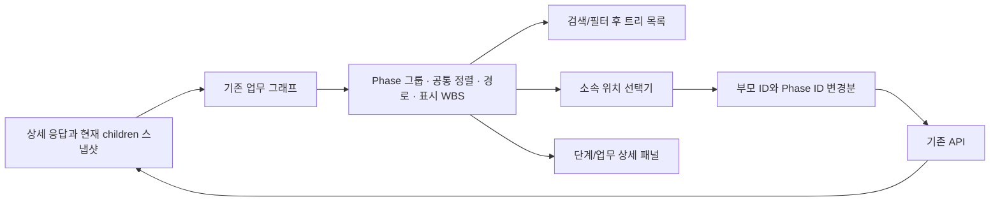

# Flowra 프로젝트 단계·업무 계층 및 UI/UX 통합 설계

작성일: 2026-10-13. 상태: 분석·설계 완료, 구현 전. 최신 첨부 요구사항과 기존 1차·2차·보완·계약 반영·UI 개선 기록, 현재 소스를 함께 검토했다. 이번 작업에서는 이 설계 문서만 추가하며 제품 코드와 기존 미커밋 변경은 유지한다.

## 1. 설계 기준과 사용자 확정 사항

- 업무 깊이는 현재 API의 `depth_level` 1~5를 유지한다. 프로젝트와 Phase는 업무 깊이에 포함하지 않는다. Phase 수나 표시 WBS의 구간 수에 별도 5 제한을 두지 않는다. Phase가 많은 프로젝트와 긴 경로도 표시할 수 있어야 한다.
- 생성·수정 폼에는 하나의 `소속 위치` 입력을 제공한다. 위치 선택기 안에 실제 `연결 단계`를 확인·명시적으로 변경하는 보조 영역을 둔다.
- 표시 번호와 탐색 UI를 바꾸더라도 부모 업무 ID와 Phase ID는 서로 독립된 기존 관계로 유지한다.
- 접힌 상세 설정의 값, 수정하지 않은 필드, 수동 진행률 0과 자동 해제 null을 보존한다. 이 세 가지는 모든 구현 단계의 필수 회귀 조건이다.
- 기존 화면 디자인, 테이블 열, 오른쪽 패널 구조, 일반 사용자 인증과 프로젝트 권한을 유지한다. 담당자 신규 기능, 새 간트 화면, 관리자 화면은 범위에 포함하지 않는다.
- 하위 Phase는 현재 API가 지원하지 않으므로 프런트엔드에서 임의로 저장하지 않는다. 아래 백엔드 TODO와 현재 가능한 기능을 분리한다.

계약의 기준은 [기업 프로젝트 공통 API](../../devdocs/api-reference/company-projects.md)다. 과거 구현 보고서는 해당 시점의 기록으로 해석하고 현재 상태는 코드 및 이후 계약 반영 기록과 대조한다.

## 2. 기존 문서 검토와 재사용할 내용

| 확인 문서 | 이번 설계에 적용할 내용 | 현재 기준으로 바로 적용하지 않을 내용 |
| --- | --- | --- |
| [프로젝트 관리 1차](../qa/project-management-phase-one.md) | 회사 문맥·owner/manager 판정, 일반 사용자 API, 공통 디자인/폼, nullable PATCH, 결과 유실·중복 제출 보호 | 당시 업무 CRUD 미포함, 동일 날짜·summary 의미 미확인. 프로젝트 생성 후 목록 필터 초기화는 업무 생성 흐름에 복사하지 않음 |
| [프로젝트 관리 2차](../qa/project-management-phase-two.md) | 실제 부모 ID로 만든 업무 트리, 직계 children lazy 조회, 조상 문맥을 포함하는 필터, 업무 패널·취소, 모바일 표 스크롤 | 당시 Phase/Work 생성·수정 준비 중, 깊이 미확인. 이후 구현으로 해소됨 |
| [2차 보완](../qa/project-management-phase-two-supplement.md) | 최신 스냅샷 기준 관계 병합, 패널 내 로딩·실패·재시도, 사라진 항목 처리와 포커스 복원 | DTO 미확보로 기능 중단했던 상태를 현재 미지원으로 해석하지 않음 |
| [2차 계약 감사](../qa/project-phase-two-contract-audit.md) | 계약을 확인하지 않은 필드·관계를 추측하지 않는 원칙 | 과거 계약 검색 실패 및 미확인 목록을 새 구현의 전제로 사용하지 않음 |
| [2026-10-13 API 반영](../qa/api-contract-update.md) | Phase/Work 생성·수정 DTO, 업무 깊이 1~5, 부분 조회, UTC 마감, 권한·진행률·취소 효과 | 배정·의존성 API가 있다는 이유로 이번에 해당 신규 UI를 추가하지 않음. Gantt 전용 화면은 현재 없음 |
| [프로젝트 UI/UX](../qa/project-management-ui-ux.md)·[드롭다운 위치](../qa/project-dropdown-positioning.md) | 고정 제목/Footer, 본문 스크롤, 날짜 X, 모달 포커스 범위, 메뉴 위치·키보드·모바일 | 같은 개선을 다시 구현하지 않음 |
| [직전 UI 간소화](../qa/project-management-ui-simplification.md) | draft 보존, 변경분만 PATCH, 수동 0/null, 부모/Phase 독립, 마감 원본 정밀도, 공통 입력 | 완료된 상세 설정 접기를 다시 만들지 않고 기본/상세 필드 배치와 위치 입력만 조정 |
| [기존 수정 기록](../qa/2026-09-15-fixes.md)·[전체 검사 기록](../qa/2026-10-12-overall-testing.md) | 공통 셸 안전 영역·접근성 및 회귀 검사 원칙 | 다른 페이지 개선을 이번 범위에 추가하지 않음. 프로젝트를 제외한 검사 결과를 프로젝트 검증 수에 합산하지 않음 |
| [할 일 이동 선택기 설계](task-move-picker.md) | 탐색/선택 분리, 고정 Footer, 취소·Escape 포커스 복원, 모바일 높이 대응 | 일정 API에 결합된 TaskMovePicker 자체를 프로젝트 선택기로 사용하지 않음 |

이전 문서의 테스트 통과 수는 당시 구현의 검증 이력이다. 이번 설계가 구현·테스트를 통과했다는 의미로 사용하지 않는다.

## 3. 새 요구사항과 현재 구현의 차이

| 요구 영역 | 현재 실제 구현 | 이번 설계의 변경 |
| --- | --- | --- |
| 자동 WBS 번호 | 업무 패널에서 저장된 `wbs_code`만 표시 | 필터 전 원본 계층으로 표시 번호를 계산하고 목록·선택기·패널에 공유 |
| Phase/Work 구분 | Phase는 회색 그룹 행, Work는 흰색 업무 행 | 폴더/업무 아이콘, 번호+제목, 글꼴 두께, 20~24px 들여쓰기 정리 |
| Phase 펼침·접기 | 없음. 업무 펼침·접기만 있음 | Phase별 접힘 상태 추가. 데이터·업무 접힘·번호는 유지 |
| Phase 상세 패널 | 없음. Phase 행에는 수정/취소 메뉴만 있음 | 기존 업무 패널의 공통 껍질을 재사용해 Phase 내용과 선택 지원 추가 |
| 업무 상세 패널 | 기본 정보, 하위 업무 탐색·추가, 일반 문자열 경로 | 클릭 가능한 경로·공통 WBS, 상위/하위 이동 및 목록 연동 |
| 기본 생성 입력 | 이름·설명·상태·우선순위·상위 업무/단계·계획 기간 | 이름 → 소속 위치 → 계획 기간 → 상세 설정 |
| 상세 설정 | 접기·펼치기, 값 보존, 날짜/진행률/WBS/정렬 편집 완료 | 설명·상태·우선순위를 상세로 이동. 기존 값·검증·저장 정책 유지 |
| 소속 선택 | 부모와 Phase 두 드롭다운 | 탐색형 선택기 1개 + 선택기 내부 연결 단계 보조 영역 |
| 생성 이후 | 캐시 갱신 후 폼 닫기 | 반환 ID로 부모 경로를 펼치고 새 항목 확인. 필터 유지 |
| 하위 Phase | DTO와 API에 부모 관계 없음 | 선택/추가 기능을 노출하지 않고 백엔드 TODO로 분리 |
| 간트 | API·타입·무효화 연결만 있음 | 계약 회귀만 유지. 새 간트 화면은 추가하지 않음 |

현재 코드의 중심은 [ProjectWorkManager](../../artifacts/flowra-web/src/components/projects/ProjectWorkManager.tsx), [ProjectWorkFormDialog](../../artifacts/flowra-web/src/components/projects/ProjectWorkFormDialog.tsx), [projectWorkTree](../../artifacts/flowra-web/src/lib/projectWorkTree.ts), [useProjectWorkTree](../../artifacts/flowra-web/src/hooks/useProjectWorkTree.ts)다. Manager는 약 1천 줄이므로 새 기능을 모두 같은 파일에 추가하지 않고 공통 표시 모델과 패널/선택기를 분리한다.

## 4. 지원 관계와 데이터 보호

| 생성 위치/기능 | 현재 지원 | 저장 관계 |
| --- | --- | --- |
| 프로젝트 아래 Phase | 지원, phased 프로젝트만 | 기존 Phase POST. 부모 필드는 없음 |
| Phase 아래 Phase | 미지원 | 저장 불가. 가짜 부모 필드나 업무로의 대체 금지 |
| 업무 아래 Phase | 미지원 | 위치 선택 및 실행 금지 |
| 단계 미지정 최상위 업무 | 지원 | parent=null, phase=null |
| Phase 아래 최상위 업무 | 지원 | parent=null, phase=선택 Phase ID |
| 업무 아래 하위 업무 | 지원, 깊이 제한 준수 | parent=선택 업무 ID. phase는 별도로 보존/명시 선택 |

위 표의 parent/phase는 설명용 약칭이며 실제 전송 필드는 기존 `parent_work_item_id`, `company_project_phase_id`다. API 경로·메서드·DTO를 변경하지 않는다.

Phase와 Work에 같은 숫자 ID가 있을 수 있다. 선택·접힘·WBS·포커스에는 `phase:501`, `work:501`처럼 종류가 포함된 키를 사용한다. 프로젝트 및 단계 미지정 탐색 그룹도 화면 전용 키로 구분하며 DB 리소스처럼 저장하지 않는다.

수정의 원본 관계는 항상 두 ID로 보관한다. 선택 목록에 현재 부모/Phase가 없더라도 원본 ID를 남기고 정보 확인이 필요하다고 표시한다. 목록이 없다는 이유로 null 또는 다른 단계로 정규화하지 않는다.

## 5. 공통 계층·WBS 모델

### 5.1 구조와 정렬

1. 기존 그래프의 실제 부모 업무 관계를 기준으로 subtree를 유지한다. Phase는 루트 업무를 분류하는 표시 그룹이다.
2. Phase는 `sort_order → Phase ID`, 업무는 같은 부모의 `sort_order → Work ID` 순서로 정렬한다. 번호와 실제 행, 선택기, 패널이 같은 comparator를 사용한다.
3. 현재 Manager는 누락 정렬값을 0으로, 트리 유틸은 가장 뒤로 처리해 불일치가 있다. 통합 시 현재 목록의 유효 정렬값/기존 0 fallback/ID tie-break 규칙을 공통화한다. fallback은 화면 정렬에만 쓰고 서버에 저장하지 않는다. 누락·null·음수·동일 순서 테스트를 포함한다.
4. 부모와 다른 Phase에 연결된 자식은 부모 subtree 아래 한 번만 표시한다. 별도 Phase로 복제하거나 이동하지 않는다.
5. 공통 경로도 해당 루트 업무의 표시 그룹과 실제 조상으로 만든다. 현재 `workPath()`가 자식의 자체 Phase를 부모 경로 앞에 붙이는 불일치도 이 공통 모델로 해결한다.

예: 기획 Phase의 부모 업무 아래 개발 Phase에 연결된 자식이 있다면 목록·WBS·Breadcrumb는 기획 쪽 실제 부모 경로를 사용한다. 자식의 실제 연결 단계는 개발로 별도 표시하고 그대로 보존한다. Phase 필터는 기존처럼 실제 연결 Phase로 매칭하며 필요한 조상을 문맥으로 보여준다.

### 5.2 표시 번호 규칙

- Phase 번호는 `1`, `2`, `3` 순서다. Phase 아래 루트 업무는 `2.1`, 그 자식은 `2.1.1`처럼 표시한다.
- 단계 미지정 그룹 제목은 기존처럼 유지하며 가짜 Phase 번호를 붙이지 않는다. 그 그룹의 루트 업무는 Phase 수 다음의 최상위 번호를 사용한다. Phase가 2개면 단계 미지정 업무는 `3`, `4`, 자식은 `3.1`이다.
- phase_less 프로젝트는 업무 루트부터 `1`, `2`, `3`으로 시작한다.
- 번호는 제목과 같은 크기로 `2.1. 로그인 구현`처럼 한 제목 안에 표시한다. 번호를 badge나 작은 기술 코드로 표시하지 않는다.
- 번호는 화면 파생값이며 ID, `sort_order`, 저장 `wbs_code`를 대체하지 않는다. 기존 `wbs_code`는 상세 정보 및 기존 고급 수정에서 보존한다.
- 생성·명시적 이동·정렬 변경 또는 실제 원본 응답에서 항목이 제거되면 번호를 다시 계산한다. 새 드래그 정렬 기능은 이번에 추가하지 않는다.
- 현재 DELETE는 물리 삭제가 아니라 취소다. cancelled 항목도 번호의 원본에 포함한다. 상태 필터로 숨겨도 나머지 번호는 압축하지 않는다. Phase 취소는 업무의 부모·상태·번호를 자동 변경하지 않는다.
- 새 항목의 번호는 저장 후 서버 정렬과 갱신 응답으로 확정한다. 저장 전에 다음 번호/정렬 순서를 추측해서 쓰지 않는다.

### 5.3 부분 조회에서도 번호를 유지하는 방법

[조회 계약](../../devdocs/api-reference/company-projects.md)에 따르면 Phase는 전체 반환되며 상세 full은 업무 깊이 5까지, summary는 깊이 2까지의 전체 범위를 반환한다. 루트 형제와 children 직계 목록에는 페이지네이션이 없다. children `depth=1` 성공 응답은 해당 부모의 모든 직계 자식이다.

따라서 번호에 필요한 것은 전체 프로젝트를 재귀 조회하는 일이 아니라 **현재 번호 경로의 각 형제 집합이 완전한지** 확인하는 일이다.

| 현재 조회 근거 | 번호/탐색 판단 |
| --- | --- |
| 유효한 full 상세 | 모든 업무 형제 집합 확인 가능 |
| 유효한 summary 상세 | 전체 루트와 depth 1 업무의 직계 자식 집합 확인 가능. 더 깊은 자식은 탐색 시 조회 |
| 현재 상세 revision의 성공한 children depth=1 | 해당 부모의 직계 형제 집합 확인 완료 |
| 정책 누락·누락 조상·순환·손상 응답 | 원래 번호를 확정하지 않고 확인 필요 상태. 가짜 루트 번호를 만들지 않음 |
| 기간/Phase로 필터된 Gantt 응답 | 번호 원본으로 사용하지 않음. 부모가 빠질 수 있음 |

공통 번호 Map은 필터/검색/접힘 적용 전에 계산한다. 숨겨진 손자를 조회해도 이미 확인된 부모·다른 branch의 번호는 바뀌지 않는다. 생성·이동·정렬 뒤에는 새로운 상세/직계 스냅샷으로 재계산한다. 실제 변경에 따른 재번호와 단순 펼침에 따른 번호 변경을 구분한다.

`child_count`는 취소 포함 rollup 캐시이며 조회 완료 여부나 전체 결과를 증명하지 않는다. 새 번호/선택기의 완전성 판정에는 현재 snapshot의 성공 여부와 상세 depth 범위를 사용한다. 현재 hook은 child_count=0이면 기본 loadChildren 요청을 생략할 수 있으므로, 완전성을 확인하지 못한 branch를 사용자가 직접 탐색할 때는 힌트와 무관하게 depth=1 요청을 보낼 수 있는 명시 조회 기능을 추가한다. 현재 revision에서 이미 성공한 빈 응답은 그대로 완전한 빈 branch로 인정한다. 기존 목록의 기본 lazy·중복 요청 방어를 재사용하며 전체 펼치기는 로드한 범위만 펼친다. 모든 branch를 전역 자동 조회하지 않는다.

## 6. 목록 UI

Phase 행에는 폴더 아이콘, 연한 기존 그룹 배경, SemiBold 제목과 펼침 버튼을 둔다. 업무는 작업 아이콘, 기존 표면, Regular 제목을 사용한다. 들여쓰기는 표시 계층당 20~24px로 통일하되 서버 업무 depth와 별개다.

Phase 접힘 상태는 별도 Set으로 관리한다. 접어도 로드된 업무·캐시·선택·업무 자체 펼침 상태를 삭제하지 않는다. 선택한 숨겨진 업무의 패널은 유지한다. 필터가 활성화되면 일치 항목의 Phase/조상만 임시로 펼쳐 결과를 보이며, 필터 해제 후 사용자가 저장한 접힘 상태를 복원한다. 필터는 로드한 범위만 검색한다는 기존 안내를 유지한다.

Phase 선택과 메뉴/펼침 버튼의 이벤트를 구분하고 모두 키보드로 동작하게 한다. 테이블 열은 유지한다. 이름 열의 폭·최소폭·말줄임과 전체 제목 접근 방법을 점검하고 모바일 가로 스크롤은 표 안에 한정한다. 새 패널이 열렸을 때 목록과 패널 모두 읽을 수 있는 폭을 확보한다.

## 7. 생성·수정 모달과 소속 위치 선택기

### 7.1 폼 구성

| 폼 | 기본 영역 | 상세 영역 |
| --- | --- | --- |
| Phase | 단계명, 소속 위치, 계획 시작/종료일 | 설명, 상태, 실적 시작/종료일, 기존 정렬 순서 |
| Work | 업무명, 소속 위치, 계획 시작/종료일 | 설명, 상태, 우선순위, 실적 기간, 마감 날짜/시간, 자동·수동 진행률, 기존 WBS 코드·정렬 순서 |

Phase의 유효 위치는 현재 프로젝트 최상위 하나뿐이다. 같은 LocationField 표현을 쓰되 읽기 전용 위치로 안내하고 불필요한 탐색창은 열지 않는다. 하위 Phase 지원 뒤 확장할 수 있도록 인터페이스를 분리한다.

생성 상세 설정은 접힌 상태다. 수정에서는 설명, 기본값과 다른 상태/우선순위, 날짜, 마감, 수동 진행률, WBS, 0이 아닌 정렬 등 기존 설정을 확인하기 쉽게 펼침 기준을 확장한다. 새로 상세로 옮긴 필드도 접힌 오류 표시·자동 펼침 대상에 포함한다.

상태 todo, 우선순위 medium, 정렬 0 등 기존 공식 기본값을 유지한다. 정렬/WBS를 기본 화면에서 제거하더라도 생성 정렬 규칙을 바꾸거나 저장 코드를 제거하지 않는다. 생성에서 값이 없다면 공식 기본값/생략 규칙을 사용하고, 기존 고급 편집 기능은 상세 영역에 유지한다. 현재 값 보존 로직을 새 폼 라이브러리로 재작성하지 않는다.

### 7.2 선택기 화면과 동작

ProjectLocationPicker는 기존 Dialog 안의 보조 화면으로 연다. 같은 부모 컴포넌트의 draft/initial은 유지하고, 탐색 중에는 기존 폼 제출을 막는다. 헤더·본문 스크롤·Footer 구조와 공통 버튼·아이콘·포커스 패턴을 재사용한다.

- 상단: `소속 위치 선택`, 현재 확정 위치 요약, 클릭 가능한 Breadcrumb, 상위 이동.
- 본문: 현재 위치의 직계 Phase/Work 항목. 폴더/업무 아이콘, 공통 WBS, 제목, 탐색 표시. 로딩·실패/재시도·빈 계층 상태를 구분한다.
- 보조 영역: 실제 `연결 단계`와 변경 동작. 업무 부모가 있는 경우 여기에서 Phase를 바꿔도 부모를 자동 변경하지 않는다. 부모가 null이면 연결 단계와 최상위 위치의 Phase는 같은 의미이므로 보조 Phase 변경도 후보 위치를 해당 Phase/단계 미지정으로 함께 갱신한다. Phase A 위치를 선택한 채 실제 Phase B를 저장하는 모순된 미리보기는 만들지 않는다.
- 하단: 취소, `현재 위치 선택`. 후보의 생성 가능 깊이/권한/자기·자손 이동 제한을 반영하고 제한 이유를 표시한다.
- 항목 클릭은 탐색만 수행한다. Breadcrumb/상위 이동도 저장값을 바꾸지 않는다. 확정 버튼을 눌렀을 때만 draft의 관계 쌍을 갱신한다.
- 취소/Escape는 원래 폼으로 돌아가고 위치 버튼에 포커스를 복원한다. 폼 입력과 확정 관계는 유지한다. 폼 자체 닫기와 위치 탐색 취소는 구분한다. 동일 Dialog의 보조 화면 진입에는 onOpenAutoFocus가 다시 실행되지 않으므로 제목/첫 탐색 컨트롤로 포커스를 명시적으로 옮긴다. picker 모드의 Escape는 기본 Dialog 닫기를 막고 선택기만 취소하도록 처리한다.
- 주 화면 필터는 선택기에 적용하지 않는다. 필요한 branch만 기존 children 조회로 탐색한다. 미조회 항목을 전체 검색한 것처럼 표현하지 않는다.

탐색 가능한 항목과 현재 선택 가능한 부모는 별개다. 최대 깊이 업무의 하위 구조는 읽을 수 있지만 생성 위치 확정은 제한한다. 깊이 판정은 기존 helper의 확인된 업무 깊이/유효한 backend depth fallback을 재사용한다. 새 이동에서 자손 전체 깊이가 미조회라면 통과를 보장하지 않고 최종 서버 transaction 검증을 따른다. 자기 자신·확인된 자손·다른 프로젝트 후보는 선택할 수 없다.

### 7.3 위치 확정과 두 ID의 매핑

| 사용자 동작 | 신규 생성 | 기존 수정 |
| --- | --- | --- |
| 프로젝트 최상위/단계 미지정 선택 | parent=null, phase=null | 두 관계 해제를 선택한 동작임을 미리 표시하고 확정 후 해당 변경분만 전송 |
| Phase 위치 선택 | parent=null, phase=해당 ID | 루트 이동 및 Phase 변경을 미리 표시하고 명시 확정 |
| 업무 위치 선택 | parent=해당 ID. 연결 단계는 선택 업무의 실제 Phase를 초기 제안하되 보조 영역에서 명시한 값은 유지 | parent만 변경. 기존 phase는 유지하고 보조 영역에서 명시적으로 바꿀 때만 변경 |
| 선택기 내부 연결 단계만 변경 | parent 유지, phase만 변경 | parent 유지, phase만 변경 |
| 기존 위치 그대로/탐색 취소 | 확정 관계 유지 | 원본 관계 유지, PATCH에 관계 필드 생략 |

매핑 표는 보조 변경 전 후보의 기본값이다. 업무 후보에서 명시적으로 고른 보조 Phase는 기본 제안보다 우선한다. 부모가 null인 후보에서 보조 Phase를 바꾸면 후보 위치 자체가 바뀌며, 확정은 마지막 후보 위치와 관계 쌍을 그대로 반영한다. 확정 시 기본 매핑을 다시 적용해 명시 보조 변경을 덮어쓰지 않는다.

선택 확정 전 요약에서 실제 부모와 연결 단계를 확인한다. 단계와 부모가 다른 관계를 자동으로 동일하게 맞추지 않는다. 하위 업무 추가로 처음 연 폼은 현재 업무를 부모로, 부모의 실제 Phase를 수정 가능한 기본값으로 넣는 기존 동작을 유지한다. Phase 패널의 업무 추가는 parent=null, phase=현재 Phase로 연다.

## 8. 단계·업무 상세 패널

패널 선택은 숫자 ID 하나가 아니라 `{ kind: phase|work, id }`로 확장한다. 현재 리소스 정보는 최신 detail/tree에서 찾아 표시하고 선택 상태에는 종류·ID와 오류 복구용 경로/제목 문맥만 남긴다.

공통 상단은 클릭 가능한 소속 경로 → 아이콘·WBS+제목 → 상태/업무 우선순위 → 더 보기다. 긴 경로는 중간을 축약해도 전체 경로를 확인하고 키보드로 이동할 수 있게 한다. 프로젝트 Breadcrumb는 개요로, Phase/Work Breadcrumb는 해당 리소스 패널로 이동한다.

| 패널 | 정보와 하위 항목 | 추가 동작 |
| --- | --- | --- |
| Phase | 자체 설명·상태·계획/실적 기간·응답의 저장 진행률, 해당 표시 그룹의 최상위 업무 | 현재 Phase에 업무 추가. 하위 단계 추가는 미노출 |
| Work | 기존 설명·상태·우선순위·계획/실적·마감·진행률·저장 WBS·담당자 표시, 직계 하위 업무 | 기존 하위 업무 추가, 수정·취소 |

Phase 진행률은 현재 계약상 업무를 통한 자동 집계가 아니다. 응답값만 표시하고 프런트엔드에서 하위 완료율을 새로 계산하지 않는다. 없는 정보는 미설정으로 표시하며 0을 없는 값으로 취급하지 않는다. 기존 WorkProgress의 저장/rollup 구분과 담당자 ID 0 마스킹을 그대로 재사용한다.

다른 그룹의 부모 아래 있으면서 현재 Phase에 연결된 업무는 실제 하위 루트처럼 복제하지 않는다. 필요하면 Phase 패널에 `다른 상위 업무 아래 연결된 업무` 보조 목록을 로드한 범위 기준으로 구분한다. 클릭하면 원래 부모 경로의 업무 패널로 이동한다. 전체 Phase 업무 목록이라고 주장하지 않는다.

기존 데스크톱 오른쪽 패널, 내부 스크롤, 모바일 전체 화면 패널, 제목 포커스, 배경 inert, 닫기 포커스 복원을 공통 껍질로 유지한다. 목록에서 Phase도 선택 강조를 받을 수 있게 하며 가상 단계 미지정 그룹에는 리소스 수정·취소 패널을 제공하지 않는다.

## 9. 목록·선택기·패널·저장 연결

모든 항목 선택은 같은 selection 함수를 거친다. 목록 클릭, Breadcrumb, 하위 항목 클릭이 동일한 종류/ID와 경로를 사용한다. 필요한 Phase와 업무 조상만 펼치고 이미 로드한 데이터와 사용자의 다른 펼침 상태는 보존한다.

필터 밖 항목으로 패널에서 이동해도 검색·상태·우선순위·Phase 필터를 지우지 않는다. 패널에 현재 필터 밖 항목이라는 안내를 표시한다. 목록에 보이면 해당 행만 선택·스크롤한다. 보이지 않는 행을 강제로 클릭하거나 임시 복제하지 않는다. 사용자가 별도로 필터 해제를 선택한 경우만 필터를 바꾼다.

생성 성공 callback은 현재 `onSaved()`에서 종류·생성/수정 구분·검증된 반환 리소스를 전달하도록 확장한다. 새 API는 필요 없다.

1. 기존 POST/PATCH로 저장하고 반환 리소스 ID를 확인한다.
2. 기존 mutation 캐시 무효화 범위를 유지한다. 새 항목의 부모 경로와 ID를 현재 프로젝트에 묶어 잠시 보관한다.
3. 갱신 상세와 필요한 직계 children만 차례로 조회한다. summary 밖 생성도 실제 부모 경로를 따라 조회한다.
4. 현재 상세 revision에 연결된 권위 응답으로 번호를 확정하고 부모 Phase/업무를 펼친다. 필터에 보이는 행은 스크롤·선택하고, 필터 밖이면 필터 유지 안내와 상세 확인을 제공한다.
5. 저장은 성공했지만 재조회가 실패한 경우 재조회만 재시도하게 한다. 새 POST를 반복하지 않는다.

이 동작은 프로젝트 전환/최신 상세 revision에 연결한다. 이전 프로젝트의 지연 응답이나 제거된 부모의 캐시가 현재 트리를 복원하지 않게 기존 authority merge를 유지한다. 현재 API에는 여러 조회를 원자적으로 묶는 snapshot token이 없으므로 상세와 children 사이의 서버 동시 변경까지 동일 시점으로 보장한다고 표현하지 않는다. 응답 충돌 시 다시 조회해 복구한다.

새 응답 로딩·오류 때문에 선택 리소스가 잠시 보이지 않는 경우에는 복구 문맥과 재시도를 유지하되 낡은 기본 정보를 최신 값처럼 표시하지 않는다. 현재 부모/상세의 성공한 확정 응답에서 실제 항목이 사라진 경우에는 선택을 정리하고 보이는 부모/Phase 행 또는 검색으로 포커스를 복원한다. 취소는 리소스가 남는 동작이므로 단순 cancelled 전환만으로 패널을 사라진 항목처럼 처리하지 않는다.

## 10. 예상 구현 파일과 단계별 범위

| 파일/모듈 | 계획 역할 |
| --- | --- |
| 기존 `lib/projectWorkTree.ts` | 부모 그래프·깊이 규칙 보존. 필요한 공통 comparator만 정리 |
| 새 `lib/projectHierarchy.ts` | Phase 그룹·직계 목록·공통 경로·WBS·형제 조회 완전성의 표시 모델 |
| 새 `lib/projectLocation.ts` | 화면 선택과 기존 두 ID의 매핑, 명시 변경 판정·후보 검증 |
| 기존 `hooks/useProjectWorkTree.ts` | 최신 snapshot 병합 보존, 경로 펼치기/조회 완료 근거 공개, 미확인 branch의 명시 직계 탐색 지원 |
| 기존 `ProjectWorkManager.tsx`·CSS | 필터·접힘·종류별 선택·생성 후 위치 확인 조정. 목록 열/디자인 유지 |
| 기존 `ProjectWorkFormDialog.tsx` | 기본 필드 축소, 기존 draft/changed 저장 보존, 위치 보조 화면 및 저장 결과 전달 |
| 새 `ProjectLocationPicker.tsx`·`ProjectHierarchyBreadcrumb.tsx` | 탐색형 위치 선택과 공통 클릭 경로 |
| 새 `ProjectWorkDetailPanel.tsx` | 기존 패널 껍질 분리, Phase/Work 본문과 이동·추가 동작 |
| 기존 API·DTO·mutation 훅 | API 경로·필드 그대로 사용. 반환값/캐시 흐름에 필요한 UI 연결만 검토 |
| 단위/계약/E2E | 번호·위치 매핑 및 기존 데이터 보존·lazy·패널 회귀 확장 |

`ProjectDetail.tsx`는 현재 진입점·개요/업무 탭을 유지하며 프로젝트 Breadcrumb의 개요/제목 포커스 연결이 필요할 때만 제한적으로 수정한다. 프로젝트 목록과 다른 Flowra 페이지 코드는 변경 범위에서 제외한다.

| 순서 | 구현 단위 | 해당 단계 완료 기준 |
| --- | --- | --- |
| 1 | 공통 표시 계층·정렬·WBS·관계 매핑 | full/summary/children, 종류 ID 충돌, 교차 Phase, 필터 불변 번호 단위 검사 |
| 2 | 목록 번호·아이콘·Phase 접기 | 기존 열/권한/업무 lazy·검색 유지, 접기 후 값·번호 불변 |
| 3 | 위치 선택기와 폼 배치 | 탐색 취소, 보조 Phase, 기존 숨겨진 값·0/null·정확한 DTO 회귀 |
| 4 | Phase/Work 패널과 Breadcrumb | 부모·자식 이동, 최신 리소스 resolve, 모바일 포커스/복구 |
| 5 | 생성/수정 후 목록 연결 | 필터 유지, summary 밖 신규 항목 확인, 재조회 실패·지연 응답 격리 |
| 6 | 최종 타입·빌드·브라우저 검증 | 관련 회귀 및 테마/작은 화면 캡처 확인. 실제 API 미검증 범위 별도 보고 |

## 11. 검증 계획

- WBS: 동일/음수/누락 정렬, 같은 숫자 Phase·Work ID, Phase 없음·다수 Phase·미지정 업무, 교차 Phase 자식, 검색/상태 필터 후 번호 불변, 접기와 lazy 확장, stale child_count=0이어도 명시 탐색으로 실제 자식 조회, 실제 생성/이동/정렬/취소 효과, 누락 부모·순환·손상 응답.
- 위치: 프로젝트/Phase/Work 선택, 현재 위치 확정과 탐색 취소 분리, 수정의 Phase 독립 보존, 보조 Phase만 변경, 조회되지 않은 기존 ID 보존, 자기·자손/다른 프로젝트 제외, 업무 depth 5에서 추가 제한, phase_less의 Phase 미노출.
- 폼: 기본 정보만 생성, 설명·상태·우선순위의 상세 이동, 상세 오류 자동 펼침, 기존 WBS·실적·정렬·마감 보존, 자동 생성 진행률 생략, 수동 0 저장, 자동 해제 override null, 날짜 X 및 UTC 마감 정밀도, 결과 유실 중복 POST 차단.
- 패널: Phase 신규 선택, Work 기존 내용 유지, 클릭 경로·직계 항목 이동, 교차 Phase 경로 일치, 필터 밖 이동·닫기 포커스, 실제 사라짐과 로딩/오류 구분, Phase 취소와 업무 subtree 취소의 차이, 모바일 inert·Escape.
- 생성 연결: 반환 ID로 선택, 부모 경로만 펼침, summary에서 깊은 신규 업무 재조회, 필터 자동 초기화 없음, 저장 성공/조회 실패 구분, 이전 프로젝트 응답·사라진 부모 캐시 격리.
- 화면: desktop/mobile, 높이 560px 및 360/390/700px 경계, 긴 제목/번호/다수 형제, 표 내부 스크롤, 고정 Footer, 위치 화면의 키보드·포커스 복원, 밝은/어두운 테마.

실행 명령은 기존 `pnpm.cmd typecheck`, 웹 `test:api`, `test:e2e:typecheck`, `build`, 관련 `playwright test`를 사용한다. 별도 린트 스크립트가 없으므로 임의 린트 환경을 설치하지 않는다. 기존 프로젝트 계약·트리·폼 회귀를 보존하고 새 로직을 확인하는 테스트만 추가한다. 운영 API/DB의 실제 저장은 허용된 테스트 환경에서 수행할 수 있을 때 별도로 확인하고 모의 API 결과와 구분한다.

## 12. 백엔드 TODO와 이번 분석의 완료 범위

현재 API로 가능한 1차 적용 범위는 자동 표시 WBS, Phase 접기·읽기 상세, 탐색형 업무 위치, 폼 추가 간소화, 공통 Breadcrumb·패널 이동·생성 후 확인이다.

백엔드 지원이 필요한 하위 Phase는 다음을 함께 정의해야 한다: Phase 부모 관계의 저장/조회·생성/수정 지원, 허용 부모 유형, 순환·깊이·이동 검증, 형제 정렬, 업무 Phase 연결과의 관계, 하위 Phase 취소 효과, 기존 평면 Phase 호환성. 프런트엔드 설계에서 새 endpoint나 임의 DTO 필드 이름을 확정하지 않는다. 기존 Phase 진행률을 업무 집계로 바꾸는 요구도 별도 계약이 필요하며 이번 범위에 포함하지 않는다.

업무 깊이 1~5 유지와 선택기 내부 연결 단계 보조 영역은 사용자 답변으로 확정했다. 미지정 업무 번호·취소 행 번호 유지·Phase 읽기 상세 구성·단계 생성 최상위 표시 방식은 위 설계안을 기본으로 제안한다.

이번에 수행한 것은 첨부 전체 요구사항 분석, 기존 문서의 시점별 대조, 현재 코드/API·조회 정책의 정적 검토, 설계 작성이다. 제품 구현, 타입 검사, 빌드, 브라우저 테스트는 이 분석 단계에서 새로 실행하지 않았다. 앞선 작업의 미커밋 수정은 그대로 유지한다.
